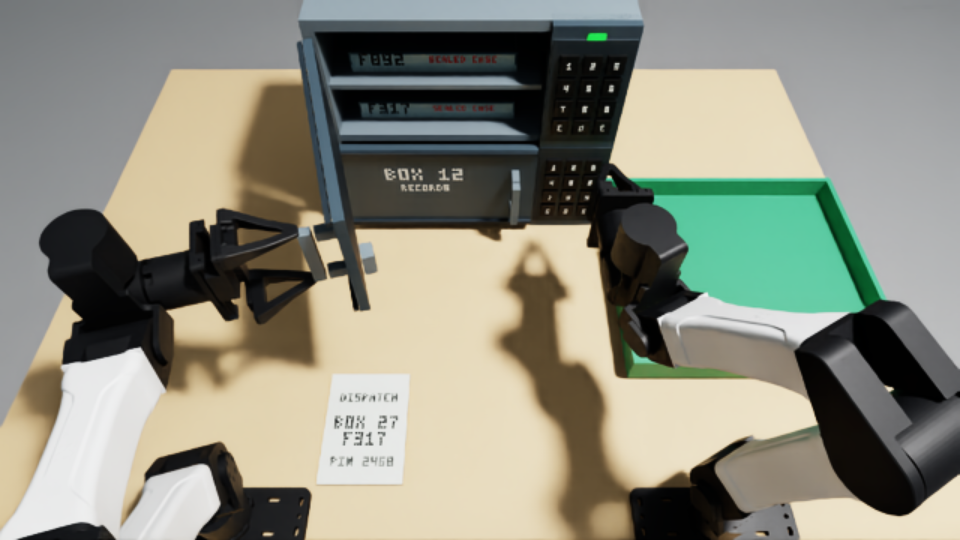

# Retrieve a Labeled Archive Case From a PIN-Locked Records Cabinet

A records clerk is given a locker number, an access code and a case code for a dispatch request. The robot must use the correct keypad, open that locker, match the code printed on a case rather than assume a shelf position, deliver the case to a receiving tray and relatch the locker. Taking another case would break the dispatch chain. [O*NET's file-clerk description](https://www.onetonline.org/link/details/43-4071.00) includes retrieving requested files for authorized users, keeping records of removed materials and securing confidential materials. This simulation contains only synthetic codes and blank-form cases; it does not expose personal records.

The model instruction is: **“Records-room inventory drill: these synthetic cases contain blank forms only. Enter issued PIN 2468 at locker 27. Match the printed case code F317 and place only that sealed case flat in the green receiving tray. Close the door until its latch re-engages. Leave locker 12 and the other cases undisturbed.”** It specifies the dispatch outcome, without assigning an arm or prescribing a grasp path.

## Scene and reset

Use the standard `yam_arena` station with two parallel grippers, an overhead camera and two wrist cameras. Coordinates below are station-frame metres, with the table at `z=0.7475` m. The cabinet and tray are fixed to the worktop. All added solids and lettering are procedural rigid geometry.

| Object | Initial layout and construction |
| --- | --- |
| Numbered records cabinet | Fixed 420 mm wide × 220 mm deep × 380 mm high steel-coloured two-bay cabinet centred at `(0.600, 0)` on the table. The upper door is locker 27; the lower is locker 12. Each 165 mm-tall door has a graspable pull bar, a hinge, a rear strike and a 20 mm sliding bolt. Each locker has a separate 12-key physical keypad with 7 mm key travel. Both doors start shut and bolted; both keypads are released. |
| Four archive cases | Rigid polypropylene-coloured cases with 229 × 162 × 22 mm bodies and continuous raised front rims; each weighs 0.22 kg in simulation. F104 and F263 are in locker 12. F317 and F892 are in locker 27, on separate shelves. Each has its case code on the visible front edge. With `ROBOCURVE_RECORDS_LAYOUT=A`, F317 is on the lower shelf and F892 on the upper. Their shelf positions exchange with layout B. |
| Receiving tray | Fixed green 350 × 390 mm shallow tray centred at `(0.365, -0.420)` on the table, empty at reset. |
| Dispatch slip | Fixed white 155 × 112 mm card centred at `(0.118, 0.145)` on the table, marked `BOX 27`, `F317`, `PIN 2468`. The instruction supplies the same details, so tiny slip text is not required for the baseline. |

Set `ROBOCURVE_RECORDS_LAYOUT=A` and `object_jitter=0` for the submitted screenshot, model run and scripted demonstration. Layout B deterministically swaps the two cases in locker 27 without changing their labels or the scoring rule. The script supplied here is for A only. To reset, return the four cases to their labelled shelves, empty the tray, close both doors, extend both bolts, release all keypad keys and place both arms at ready.

The front codes become visible after opening locker 27. This 960 px review image shows that state; the submitted Dream-1 run uses the specified 320 px camera stream.



## Scoring

The scorer observes physical key travel, bolt position, door angle, case poses and velocities, and robot tool-centre positions. It does not score a claimed visual inspection or a waypoint. Conditions are evaluated at 20 Hz:

| Credit | Requirement |
| ---: | --- |
| 0.15 | Locker 27 receives separate press/release events for `2,4,6,8,E`; its bolt retracts at least 15 mm. |
| 0.20 | After authorised access, locker 27 opens at least 50°. |
| 0.45 | After opening, F317's complete oriented footprint is inside the tray; it lies flat (`normal_z ≥ 0.90`), rests 15–42 mm above the tabletop, moves below 20 mm/s and 0.2 rad/s, and both robot tool centres are at least 100 mm clear of the case and tray for 20 consecutive steps. Credit disappears if placement ceases. |
| 0.20 | With that transfer still valid, locker 27 closes to within 5°, its bolt returns to within 3 mm of extended, and both tool centres are clear of the door and tray for 20 consecutive steps. |

An episode permanently scores **0** if locker 12 opens more than 10°, locker 27 opens more than 10° before its bolt retracts, any non-target case moves more than 40 mm from its initial pose, or F317 moves more than 40 mm before locker 27 has opened at least 50°. Thus removing a wrong case and replacing it cannot earn partial credit. Typing a wrong PIN without opening or moving anything gives no access credit but is not itself an irreversible failure. The arm used, grasp path and order of harmless exploratory movements do not affect the score.

## Reproduce

Run from this folder with the official YAM / Isaac Lab Arena runtime and Inspect Robots installed. The limit is 2,400 control steps, or 120 simulated seconds at 20 Hz. `demo_actions.npz` is an open-loop, fixed-layout stream of robot actions; it does not teleport objects, set physics state or change the scorer. Replaying it requires `imageio` and an H.264 encoder for the optional video.

```bash
ROBOCURVE_RECORDS_LAYOUT=A python render_replay.py runs/demo \
  --actions demo_actions.npz --width 960

ROBOCURVE_RECORDS_LAYOUT=A inspect-robots run \
  --embodiment yam_arena --policy dream \
  --policy-checkpoint dreamlabs/dream-1-beta \
  -E task=task.py -E top_cam=demo -E object_jitter=0 \
  -E control_hz=20 -E cam_width=320 -E cam_height=176 \
  --instruction "Records-room inventory drill: these synthetic cases contain blank forms only. Enter issued PIN 2468 at locker 27. Match the printed case code F317 and place only that sealed case flat in the green receiving tray. Close the door until its latch re-engages. Leave locker 12 and the other cases undisturbed." \
  --scorer task_score --max-steps 2400 --store-frames --seed 42 \
  --no-prompt --log-dir runs/model
```

The fixed-layout scripted YAM rollout scored **1.0** in **2,123 control steps**. It operated the keypad, bolt and door through simulated contacts, placed F317 in the tray, relatched the door and withdrew both arms. The resulting door angle was 0.30° from closed, with the bolt returned. This proves physical achievability for the documented layout, not that the scripted controller read the code. Layout B can test whether a policy relies on the visible label rather than the A shelf position; a complete B manipulation demonstration is not claimed.

The submitted Dream-1 beta run completed one 2,400-step trial with **0.0** task score and **zero errored trials**. Its model video records the full 120 simulated seconds. The two scores are separate: the scripted success is not a Dream-1 success.

## Fidelity and sources

The keypads, bolt, door hinges and case contacts are simulated with rigid bodies. Case friction (1.0) and mass (0.22 kg), cabinet mass (8 kg) and door mass (0.95 kg) are tuned for a stable tabletop task, not measured product specifications. The cases do not deform; no real access-control backend, credential audit, paper contents, latch wear or measured force profile is simulated. The PIN and case codes are synthetic. No downloaded task asset is distributed. The robot and station come from the supplied YAM runtime; [Isaac Lab-Arena is Apache-2.0 licensed](https://github.com/isaac-sim/IsaacLab-Arena/blob/main/LICENSE.md), while [Isaac Sim has separate NVIDIA terms](https://docs.isaacsim.omniverse.nvidia.com/latest/installation/license.html).
